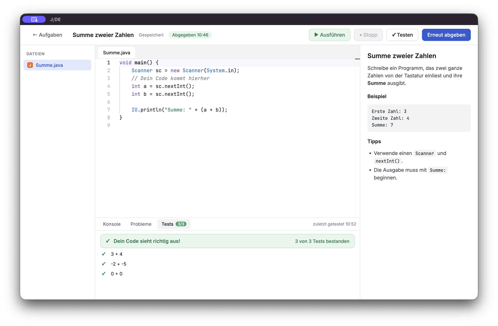

<p align="center">
  
</p>

# J;DE

J;DE is a small Java IDE for one school class: students write, run and test Java programs in an Electron app (online mode with a personal code, or an offline exam mode), download exercises their teacher unlocked and hand in their work. Teachers manage courses, students, exercises and hand-ins in a small web app. See [SPEC.md](SPEC.md) for the full specification.



## Layout

| Folder | Content |
|---|---|
| `app/` | Electron app for students (editor, running, tests, hand-in) |
| `backend/` | Hono + MariaDB API |
| `teacher/` | SvelteKit static single-page app for teachers |
| `shared/` | Types, exercise format, test format and API types used by app and backend |
| `java-helper/` | Java helper that compiles and runs student code |
| `examples/` | Sample exercises (also used as test fixtures) |

## Local development

```bash
docker compose up -d     # MariaDB on localhost:3307 (also needed by the backend tests)
npm install
npm run dev              # starts the Electron app (electron-vite dev), nothing else
```

`npm run dev` only runs the app. It starts in online mode against the local backend (`http://localhost:3000`); with `JIDE_EXERCISES_DIR=examples npm run dev` it uses a local exercise folder instead, without login. The server side runs separately, each in its own terminal:

```bash
cp backend/.env.example backend/.env   # optional, the defaults match docker-compose.yml
npm run dev -w @jide/backend           # API on http://localhost:3000, migrations run on start
npm run dev -w @jide/teacher           # teacher app on http://localhost:5174, proxies /api to :3000
npm run teacher:add -w @jide/backend -- you@example.org "Your Name"   # first teacher account
```

Sign-in mails are printed to the backend console while `SMTP_HOST` is empty. More in [backend/README.md](backend/README.md).

Checks, from the repo root:

```bash
npm run typecheck
npm test                 # backend tests need the MariaDB from docker compose
npm run test:e2e         # Playwright tests of the Electron app (online ones need the MariaDB too)
```

## Documentation

- [SPEC.md](SPEC.md): specification; the exercise format is in [section 4](SPEC.md#4-exercise-format)
- [docs/release.md](docs/release.md): building and publishing the Windows app
- [docs/exam-mode.md](docs/exam-mode.md): the exam folder for the Angabelaufwerk and how to test it
- [docs/deployment.md](docs/deployment.md): deploying backend and teacher app to the server
