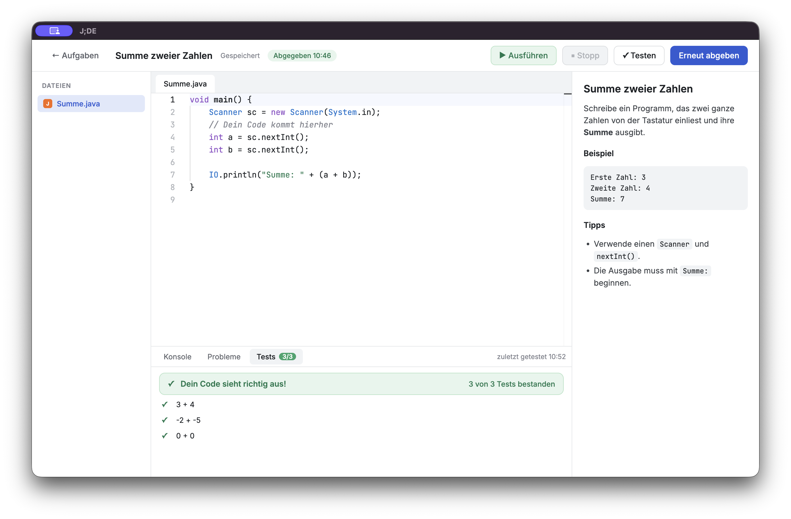

<p align="center">
  
</p>

# J;DE

**J;DE ist eine Java-Entwicklungsumgebung für Einsteiger:innen, vor allem für den 1. Jahrgang Informatik an HTLs.** Schüler:innen schreiben, starten und testen ihre Programme in einer App, laden die Aufgaben, die ihre Lehrkraft freigeschaltet hat, und geben mit einem Klick ab. Lehrkräfte verwalten Kurse, Aufgaben und Abgaben in einem Lehrer-Web.

**Handbuch für Lehrkräfte: https://mfreimueller.github.io/jide/**



## Was J;DE kann

**Schüler:innen-App** (Windows und Linux)

- Editor, der den Code nach kurzer Pause prüft; Fehlermeldungen des Compilers auf Deutsch
- Programme starten, Eingaben (z. B. mit `Scanner`) direkt in der Konsole
- „Testen“ führt die Tests der Lehrkraft aus und gibt Rückmeldung
- Abgeben mit einem Klick, mehrmals möglich (es zählt die letzte Abgabe)
- Einmalige Anmeldung mit persönlichem Code, kein Herumschieben von Dateien
- Scratch-Bereich für eigene Programme und zum Üben; Übungs-Links von der Kursseite öffnen sich mit einem Klick in der App
- Automatische Updates, Dunkelmodus (Ansicht > Darstellung), Bereiche lassen sich in eigene Fenster abtrennen
- Der Installer bringt Java mit; keine Administratorrechte nötig

**Lehrer-Web**

- Kurse anlegen, Schüler:innen eintragen, Codezettel zum Ausdrucken
- Aufgaben als ZIP hochladen, pro Kurs freischalten, in Gruppen ordnen, Fristen setzen
- Abgabe-Matrix mit allen Abgaben eines Kurses, Beurteilungen, Zugriff über API-Schlüssel (z. B. für das Programm Grader)
- Erlaubte Übungs-Hosts pro Kurs für Übungs-Links

**Prüfungsmodus**

- Dieselbe App, vom schreibgeschützten Angabelaufwerk gestartet, ohne Internet
- Die Aufgaben liegen als Ordner neben der App, die Abgabe wird auf das Laufwerk der Schüler:innen kopiert

## Download

Die App gibt es auf der [Seite der Programmversionen](https://github.com/mfreimueller/jide/releases):

- Windows: Installer `JDE-Setup-<Version>.exe`
- Linux: `JDE-<Version>.AppImage`
- Prüfungsordner: `JDE-Exam-<Version>.zip`

Die Installation steht im Handbuch im Kapitel [Die App für Schüler:innen](https://mfreimueller.github.io/jide/app), der Prüfungsordner im Kapitel [Prüfungsmodus](https://mfreimueller.github.io/jide/pruefungsmodus).

## Einsatz an der eigenen Schule

Für den Online-Modus brauchen Sie einen eigenen Server:

- den Server (`backend/`, Node.js) mit einer MariaDB-Datenbank
- einen Mailserver (SMTP) für die Anmelde-Links der Lehrkräfte
- das Lehrer-Web (`teacher/`, statische Seite) auf derselben Domain
- die App, gebaut mit der Adresse Ihres Servers

Eine Übersicht steht im Handbuch im Kapitel [Selbst hosten](https://mfreimueller.github.io/jide/selbst-hosten). Die Schritte stehen in [docs/deployment.md](docs/deployment.md) (Server und Lehrer-Web), [docs/release.md](docs/release.md) (App bauen und veröffentlichen) und [docs/exam-mode.md](docs/exam-mode.md) (Prüfungsordner).

## Entwicklung

| Ordner | Inhalt |
|---|---|
| `app/` | Electron-App für Schüler:innen (Editor, Starten, Tests, Abgabe) |
| `backend/` | API mit Hono und MariaDB |
| `teacher/` | SvelteKit-Single-Page-App für Lehrkräfte (statisch) |
| `shared/` | Typen, Aufgabenformat, Testformat und API-Typen für App und Server |
| `java-helper/` | Java-Hilfsprogramm, das den Schülercode kompiliert und startet |
| `manual/` | Handbuch für Lehrkräfte (VitePress) |
| `examples/` | Beispielaufgaben (auch Testdaten) |

```bash
docker compose up -d     # MariaDB auf localhost:3307 (auch für die Server-Tests nötig)
npm install
npm run dev              # startet nur die Electron-App (electron-vite dev)
```

`npm run dev` startet die App im Online-Modus gegen den lokalen Server (`http://localhost:3000`). Mit `JIDE_EXERCISES_DIR=examples npm run dev` nutzt sie stattdessen einen lokalen Aufgabenordner, ohne Anmeldung. Weitere Varianten (die Umgebungsvariablen wirken nur in der nicht gepackten Dev-App):

```bash
# Online-Modus gegen einen anderen Server (Standard: http://localhost:3000)
JIDE_API_URL=https://jide.example.org npm run dev

# Prüfungsmodus: Ordner mit exam.json und exercises/ (handInPath ist ein lokaler Ordner statt P:)
mkdir -p /tmp/jde-exam/exercises /tmp/jde-abgabe
cp -r examples/summe examples/maximum /tmp/jde-exam/exercises/
echo '{"mode":"exam","title":"Probe","handInPath":"/tmp/jde-abgabe","jdkPath":null,"allowTests":true}' > /tmp/jde-exam/exam.json
JIDE_EXAM_DIR=/tmp/jde-exam npm run dev
```

Die Serverseite läuft getrennt, jeweils in einem eigenen Terminal:

```bash
cp backend/.env.example backend/.env   # optional, die Standardwerte passen zu docker-compose.yml
npm run dev -w @jide/backend           # API auf http://localhost:3000, Migrationen laufen beim Start
npm run dev -w @jide/teacher           # Lehrer-Web auf http://localhost:5174, leitet /api an :3000 weiter
npm run teacher:add -w @jide/backend -- you@example.org "Ihr Name"   # erstes Lehrer-Konto
```

Solange `SMTP_HOST` leer ist, stehen die Anmelde-Links in der Konsole des Servers. Mehr in [backend/README.md](backend/README.md).

Prüfungen, im Hauptordner:

```bash
npm run typecheck
npm test                 # Server-Tests brauchen die MariaDB aus docker compose
npm run test:e2e         # Playwright-Tests der Electron-App (die Online-Tests brauchen auch die MariaDB)
```
